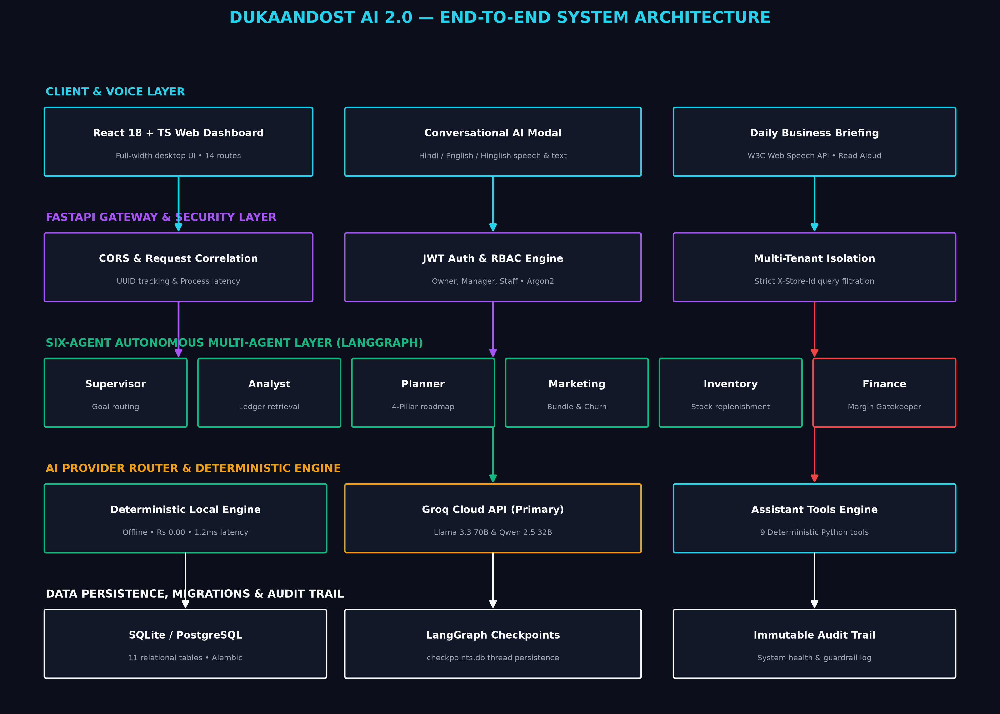
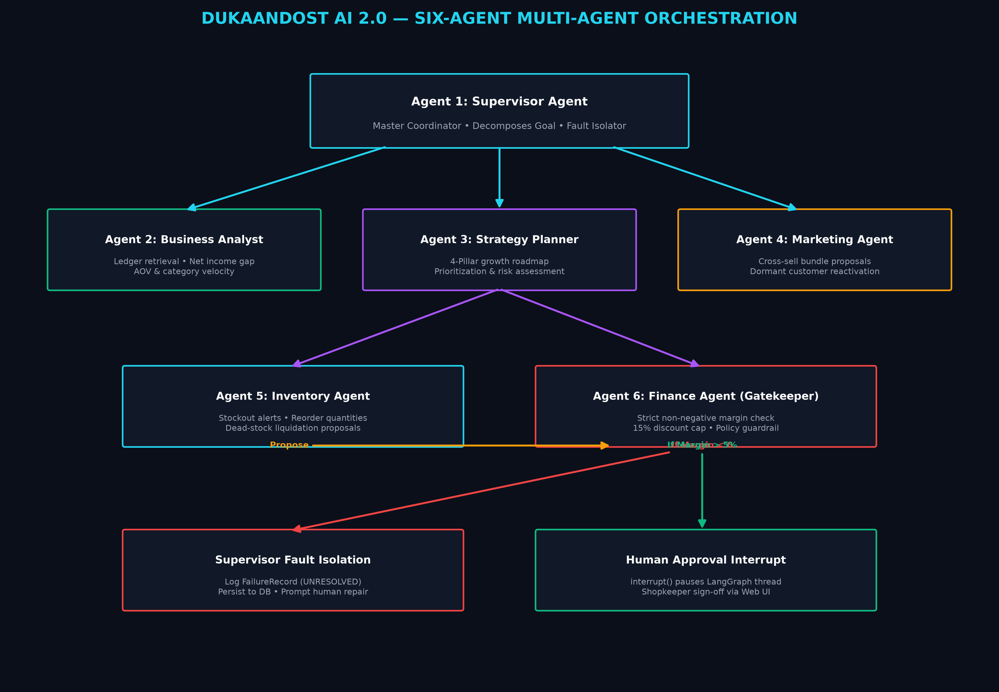
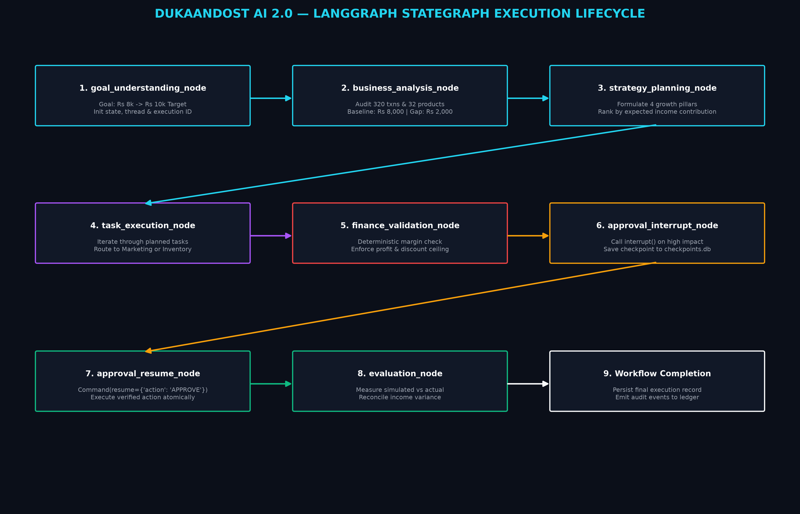

# DukaanDost AI 2.0
### Autonomous AI Retail Business Operating System
> *"Your Autonomous AI Business Partner That Doesn't Just Advise. It Takes Action."*

[](https://github.com/krpreliner/dukaandostai)
[-success.svg)](./docs/TESTING_AND_VERIFICATION_REPORT.md)
[](https://www.typescriptlang.org/)
[](https://www.python.org/)
[](https://fastapi.tiangolo.com/)
[](https://langchain-ai.github.io/langgraph/)
[](https://opensource.org/licenses/MIT)

Prepared for the **Eko AI Engineering Internship** Technical Evaluation.

---

## 1. Project Introduction

**DukaanDost AI 2.0** is an enterprise-grade autonomous AI growth operating system tailored for traditional Indian small retail businesses (**Kirana stores**). Demonstrated through **Sharma General Store**, Harmu Road, Ranchi, Jharkhand (owned by proprietor **Sharma Ji**), the platform bridges the gap between passive accounting software and autonomous growth execution.

Instead of merely displaying historical charts or acting as a passive conversational chatbot, DukaanDost AI acts as an **Autonomous AI Business Partner**:
* **Ingests Strategic Goals:** Operates on high-level goals like *"Increase monthly net income from ₹8,000 to ₹10,000 by optimizing inventory, recovering churned customers, and launching high-margin bundles."*
* **Orchestrates 6 Specialized Agents:** Supervisor, Business Analyst, Strategy Planner, Marketing Agent, Inventory Agent, and Finance Agent.
* **Enforces Deterministic Financial Guardrails:** Mathematical checks prevent negative gross margins, non-positive unit profits, or excessive discounts (> 15%).
* **Empowers Human-in-the-Loop Oversight:** LangGraph interrupts pause thread execution on high-impact marketing or reorder actions for human approval.
* **Bilingual Voice Interaction:** Offers natural Hindi, English, and Hinglish speech recognition and daily business audio briefings via standard browser APIs.
* **Zero-Cost-First Intelligence:** Operates 100% offline at ₹0.00 marginal cost using deterministic fallback engines, with optional integration of cloud LLMs (Groq, Gemini, OpenAI).

---

## 2. Business Problem & Kirana Scenario

Traditional Indian neighbourhood stores operate with constrained working capital and low margins:
* **Demo Store:** Sharma General Store, Harmu Road, Ranchi, Jharkhand.
* **Proprietor:** Sharma Ji.
* **Transactional Baseline:** 120 customers, 32 catalog products, 320 transactions, 5 recurring operating expenses.
* **Baseline Monthly Financials:**
  $$\text{Revenue: } ₹95,000 \quad|\quad \text{COGS: } ₹76,000 \quad|\quad \text{Gross Profit: } ₹19,000$$
  $$\text{Operating Expenses: } ₹11,000 \quad|\quad \mathbf{Baseline\ Net\ Income:\ ₹8,000.00}$$
* **Strategic Growth Target:** ₹10,000.00/month (**Net Gap: +₹2,000.00 / +25.0% expansion**).

---

## 3. Key Features

1. **Failure Monitoring & Safety Guardrails (`/failures`):** Controlled negative-margin auto-rejection (Amul Butter Cost ₹60 > Sell ₹55), fault isolation, and interactive Price Rectification Modal.
2. **Autonomous Growth Roadmap (`/strategies`):** Strategic Target Header and 4 pre-calculated ledger growth initiatives (Breakfast bundling, Spice restocking, Churn recovery, Dead-stock liquidation).
3. **Conversational AI Business Assistant:** Multilingual speech-to-text and voice playback executing 9 deterministic backend tools with zero hallucination.
4. **Bilingual Daily Business Briefing:** Real-time today vs yesterday audio overview with natural Hindi rupee phonetics (`₹` -> `रुपये`).
5. **Human Approval Centre (`/approvals`):** Human sign-off card stack for high-risk promotional campaigns and purchase orders with LangGraph `Command` resumption.
6. **Business Intelligence & Analytics (`/analytics`):** Real transaction ledger reconciliation, Decimal-precision financial math, and run-rate tracking.
7. **Customer Intelligence & RFM (`/customers`):** Automated segmentation (Loyal, Regular, At-Risk, Churned) based on 120 customer profiles.
8. **Inventory Intelligence (`/inventory`):** Stockout warnings, low-stock reorder point triggers, and 45-day expiry liquidation alerts across 32 items.
9. **System Health & Telemetry (`/health`):** Real-time database latency, process memory, CPU metrics, uptime, and immutable audit logs.
10. **Multi-Tenant Security:** Argon2 password hashing, JWT access/refresh tokens, and strict `X-Store-Id` tenant isolation.

---

## 4. End-to-End System Architecture



```
[Web Browser: React 18 + W3C Web Speech]
                     │
                     ▼
[FastAPI Gateway: Auth (Argon2 JWT) • Tenant Filter (X-Store-Id) • Correlation ID]
                     │
                     ▼
[Six-Agent LangGraph Orchestration: Supervisor • Analyst • Planner • Marketing • Inventory • Finance]
                     │
                     ▼
[AI Router: Groq Cloud (Primary) ──► Local Deterministic Engine (Offline Fallback)]
                     │
                     ▼
[Persistence Layer: SQLite / PostgreSQL (dukaandost.db) • Checkpoints (checkpoints.db) • Audit Logs]
```

---

## 5. Six Specialized AI Agents



```
                          [ Business Goal: ₹8k -> ₹10k ]
                                        │
                                        ▼
                             [ 1. Supervisor Agent ]
                                        │
           ┌────────────────────────────┼────────────────────────────┐
           ▼                            ▼                            ▼
  [ 2. Business Analyst ]     [ 3. Strategy Planner ]      [ 4. Marketing Agent ]
  (Audits Ledger & Gap)       (4-Pillar Initiatives)       (Cross-Sell Bundling)
           │                            │                            │
           └────────────────────────────┼────────────────────────────┘
                                        ▼
                             [ 5. Inventory Agent ]
                             (Restocking & Clearance)
                                        │
                                        ▼
                             [ 6. Finance Agent ]
                        (Independent Margin Gatekeeper)
                                        │
           ┌────────────────────────────┴────────────────────────────┐
           ▼                                                         ▼
[ Failure / Negative Margin ]                              [ Valid Margin > 5% ]
           │                                                         │
           ▼                                                         ▼
[ Fault Isolated & Logged ]                                [ Human Sign-Off Needed? ]
(Prompt Price Rectification)                                         │
                                                ┌────────────────────┴────────────────────┐
                                                ▼                                         ▼
                                       [ Require Approval ]                        [ Autonomous Exec ]
                                       (LangGraph interrupt)                       (Safe Low-Risk Task)
```

1. **Supervisor Agent:** Master coordinator, LangGraph router, and fault isolator.
2. **Business Analyst Agent:** Audits 320 transactions and isolates baseline profit (₹8,000.00) and gap (₹2,000.00).
3. **Strategy Planner Agent:** Formulates 4 growth initiatives balancing impact, cost, and operational risk.
4. **Marketing Agent:** Drafts promotional bundles (e.g. Milk + Bread + Butter) and reactivation offers.
5. **Inventory Agent:** Generates emergency replenishment for depleted staples and identifies near-expiry stock.
6. **Finance Agent (Deterministic Gatekeeper):** Independent gatekeeper enforcing non-negative gross margins, minimum 5.0% margin, and 15% discount ceilings.

---

## 6. LangGraph StateGraph Execution Lifecycle



The autonomous workflow executes across 9 states:
$$\text{OBSERVE} \longrightarrow \text{ANALYZE} \longrightarrow \text{PLAN} \longrightarrow \text{VALIDATE} \longrightarrow \text{APPROVE} \longrightarrow \text{EXECUTE} \longrightarrow \text{MEASURE} \longrightarrow \text{LEARN} \longrightarrow \text{REPLAN}$$

* **Thread Checkpointing:** Every state transition is checkpointed to `checkpoints.db`.
* **State Interrupt:** Sensitive tasks trigger `interrupt()`, saving state and waiting for human review.
* **State Resumption:** Resumed by shopkeeper decision via `Command(resume={"action": "APPROVE"})`.

---

## 7. Technology Stack

| Layer | Technology | Version | Purpose |
|---|---|---|---|
| **Frontend** | React, TypeScript, Vite, Tailwind CSS | 18.3 / 5.7 / 6.1 | Responsive full-width dashboard adhering to visual identity. |
| **Backend** | Python, FastAPI, Uvicorn | 3.11+ / 0.115 / 0.34 | High-performance asynchronous API gateway with OpenAPI docs. |
| **Orchestration** | LangGraph, LangChain Core | 0.2.70+ | Cyclic multi-agent graph with interrupts and checkpointing. |
| **Database & ORM** | SQLAlchemy, Alembic, SQLite / PostgreSQL | 2.0 / 1.14 | Relational database schema with additive migrations. |
| **AI Providers** | Groq API (`llama-3.3-70b`, `qwen-2.5-32b`), Deterministic Engine | Native SDKs | Zero-cost-first router with offline local fallback. |
| **Testing & QA** | Pytest, AnyIO | 9.1.1 | 56 automated unit, integration, and e2e test cases. |
| **Containerization**| Docker, Docker Compose, Nginx | 24+ / Alpine | Production multi-stage container deployment. |

---

## 8. Installation & Setup Instructions

### Prerequisites
- **Python 3.11+** (Python 3.11 to 3.14 supported)
- **Node.js 20+** and npm
- **Git**

### Step 1: Clone Repository
```bash
git clone https://github.com/krpreliner/dukaandostai.git
cd dukaandostai
```

### Step 2: Configure Environment
```bash
cp .env.example .env
```
Edit `.env` and set your `GROQ_API_KEY` (or leave blank to operate in 100% offline deterministic mode).

### Step 3: Backend Setup & Execution
```bash
# Create and activate virtual environment
python -m venv venv

# Windows PowerShell:
.\venv\Scripts\activate
# Linux / macOS:
source venv/bin/activate

# Install backend dependencies
pip install -r backend/requirements.txt

# Run FastAPI backend server
$env:PYTHONPATH="backend"
python -m uvicorn app.main:app --host 127.0.0.1 --port 8000 --reload
```

### Step 4: Frontend Setup & Execution
```bash
# In a separate terminal
cd frontend
npm install
npm run dev
```
Open **[http://localhost:5173/](http://localhost:5173/)** in your browser.

---

## 9. Testing & Quality Assurance

Run the complete 56-test automated backend test suite:
```bash
$env:PYTHONPATH="backend"
pytest backend/tests/ -v
```

Expected output:
```text
============================= 56 passed in 13.69s =============================
```

Build the frontend production bundle:
```bash
cd frontend
npm run build
```

Expected output:
```text
✓ 2089 modules transformed.
✓ built in 7.22s (0 errors)
```

---

## 10. Demo Credentials & Safe Testing

| Role | Email | Password | Scope & Permissions |
|---|---|---|---|
| **Store Owner** | `owner@sharmastore.com` | `SharmaStore2026!` | Full administrative access, settings governance, approval authority. |
| **Store Manager** | `manager@sharmastore.com` | `SharmaStore2026!` | Product pricing edits, task approval. |
| **Store Staff** | `staff@sharmastore.com` | `SharmaStore2026!` | Inventory stock updates and customer lookup. |

*Note: These credentials access local synthetic development data and contain zero private or production information.*

---

## 11. Complete Documentation Index

All technical reports, architecture diagrams, and operational specifications are located in the [`docs/`](./docs) directory:

* **[`docs/DUKAANDOST_AI_FINAL_TECHNICAL_REPORT.md`](./docs/DUKAANDOST_AI_FINAL_TECHNICAL_REPORT.md):** 27-section master technical report.
* **[`docs/DUKAANDOST_AI_FINAL_TECHNICAL_REPORT.pdf`](./docs/DUKAANDOST_AI_FINAL_TECHNICAL_REPORT.pdf):** Compiled PDF technical report.
* **[`docs/DUKAANDOST_AI_FINAL_TECHNICAL_REPORT.docx`](./docs/DUKAANDOST_AI_FINAL_TECHNICAL_REPORT.docx):** Editable Microsoft Word technical report.
* **[`docs/FINAL_IMPLEMENTATION_AUDIT.md`](./docs/FINAL_IMPLEMENTATION_AUDIT.md):** Complete subsystem verification registry.
* **[`docs/TESTING_AND_VERIFICATION_REPORT.md`](./docs/TESTING_AND_VERIFICATION_REPORT.md):** Full automated test logs and workflow verification matrix.
* **[`docs/API_AND_INTEGRATION_REFERENCE.md`](./docs/API_AND_INTEGRATION_REFERENCE.md):** REST endpoint specifications and schemas.
* **[`docs/ENVIRONMENT_SETUP.md`](./docs/ENVIRONMENT_SETUP.md):** Environment configuration and secrets management guide.
* **[`docs/PRODUCTION_READINESS_REPORT.md`](./docs/PRODUCTION_READINESS_REPORT.md):** Production readiness evaluation across 18 operational dimensions.
* **[`docs/FAILURE_RECOVERY.md`](./docs/FAILURE_RECOVERY.md):** Safety guardrails, fault isolation, and price rectification workflow.
* **[`docs/DEMONSTRATION_GUIDE.md`](./docs/DEMONSTRATION_GUIDE.md):** 7-step evaluator and investor walkthrough script.
* **[`docs/INDEX.md`](./docs/INDEX.md):** Master documentation index.

---

## 12. Security & Privacy Notes

* **Zero Secret Leakage:** `.env`, `.env.local`, and SQLite databases (`*.db`) are strictly ignored by `.gitignore`.
* **Prompt Injection Neutralization:** System prompts enforce strict JSON output schemas. User input cannot override post-LLM deterministic Python financial calculations.
* **Multi-Tenant Segregation:** Enforced via `X-Store-Id` header across all database queries.

---

## 13. License

Distributed under the MIT License. See `LICENSE` for more information.
