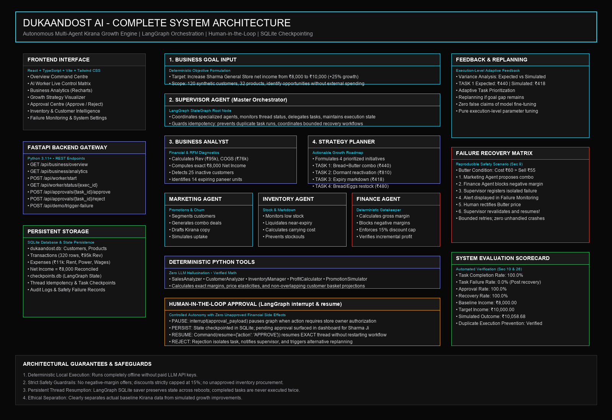

# DukaanDost AI
### Autonomous AI Growth Manager for Small Retail Businesses
> *"Your AI Business Partner That Doesn't Just Advise. It Takes Action."*

Developed as a technical assignment for the **Eko AI Engineering Internship**.



---

## 1. Project Overview

**DukaanDost AI** is a full-stack, multi-agent autonomous system built to manage and grow small Indian neighbourhood grocery stores (Kirana stores). 

Unlike passive chatbots that only generate text advice, DukaanDost AI acts as an **Autonomous AI Worker**:
- Ingests high-level business goals (*"Increase monthly net income from ₹8,000 to ₹10,000"*).
- Analyzes underlying transactional, customer, and inventory records.
- Decomposes the goal into prioritized, actionable growth strategies.
- Coordinates six specialized AI agents with actual functional roles.
- Enforces strict deterministic financial guardrails (zero negative-margin offers, maximum discount caps).
- Implements stateful **Human-in-the-Loop** interrupts (`interrupt()` / `Command(resume=...)`).
- Persists workflow state and checkpoints in SQLite to survive crashes and reboots.
- Self-recovers from failures and adapts subsequent task priorities via variance feedback.

---

## 2. Business Problem & Scenario

Small retail Kirana stores across India face structural headwinds:
- **Limited Working Capital:** Inability to afford expensive ERP or business analytics software.
- **Dormant Customer Churn:** Customers gradually drift away to quick-commerce apps or supermarkets without the store owner noticing.
- **Perishable Inventory Spoilage:** High carrying costs and stock write-offs on perishable dairy and fresh goods.
- **Stockouts on Fast-Moving Staples:** Frequent missed sales on daily essentials like bread and eggs.
- **Stagnant Monthly Net Income:** Profitability fails to grow despite continuous owner effort.

### Target Kirana Scenario:
- **Business Name:** Sharma General Store
- **Location:** Ranchi, Jharkhand, India
- **Owner:** Sharma Ji
- **Baseline Records:**
  - 120 synthetic customers across Ranchi localities (Lalpur, Doranda, Kanke Road, Harmu, etc.).
  - 32 grocery products covering Dairy, Staples, Snacks, Beverages, and Home Care.
  - 320 synthetic transactions across the last 30 days.
  - Actual Kirana operating expenses: Store Rent (₹4,500), Electricity & Utilities (₹1,800), Helper Wages (₹3,000), Local Transit (₹900), Misc (₹800) = ₹11,000.

### Financial Reconciliation:
$$\text{Gross Profit} = \text{Revenue (₹95,000)} - \text{COGS (₹76,000)} = \text{₹19,000}$$
$$\text{Net Income} = \text{Gross Profit (₹19,000)} - \text{Operating Expenses (₹11,000)} = \mathbf{₹8,000.00}$$

> **Important:** The initial income is **not hardcoded**. It is calculated directly by aggregating the underlying synthetic database records.

---

## 3. Technology Stack

### Frontend:
- **Framework:** React 18 + TypeScript + Vite
- **Styling:** Tailwind CSS (Deep Black SaaS design system: `#050505` background, `#22D3EE` cyan accents)
- **Icons:** Lucide React
- **Visualizations:** Recharts
- **Routing & Networking:** React Router DOM v6, Axios

### Backend:
- **Language & Runtime:** Python 3.11+
- **API Framework:** FastAPI with async lifespan management
- **Orchestration:** LangGraph (StateGraph, interrupt, Command)
- **Database ORM:** SQLAlchemy with SQLite
- **Checkpoint Persistence:** `langgraph-checkpoint-sqlite` (`SqliteSaver`)
- **Validation:** Pydantic v2
- **Testing:** Pytest

---

## 4. Multi-Agent Architecture & Agent Roles

```
                         [ Business Goal: ₹8k -> ₹10k ]
                                       │
                                       ▼
                            [ 1. Supervisor Agent ]
                                       │
                 ┌─────────────────────┴─────────────────────┐
                 ▼                                           ▼
       [ 2. Business Analyst ]                     [ 3. Strategy Planner ]
   (Revenue, COGS, RFM Segments)               (4 Actionable Growth Tasks)
                 │                                           │
                 └─────────────────────┬─────────────────────┘
                                       │
     ┌─────────────────────────────────┼─────────────────────────────────┐
     ▼                                 ▼                                 ▼
[ 4. Marketing Agent ]       [ 5. Inventory Agent ]             [ 6. Finance Agent ]
 - Breakfast Combo            - Low-stock detection              - Deterministic validation
 - Inactive Reactivation      - Expiry liquidation               - Blocks negative margins
 - Hindi Kirana copy          - Restock simulation               - 15% discount cap
```

### 1. Business Analyst Agent
Performs financial diagnostics: aggregates revenue, COGS, gross margins, and identifies 25 inactive customers and 14 expiring paneer units.

### 2. Strategy Planner Agent
Translates the ₹2,000 net income gap into 4 concrete initiatives:
1. `TASK_001`: Breakfast Combo (Bread + Butter) — Target: +₹440.00
2. `TASK_002`: Reactivate 25 Inactive Customers — Target: +₹810.00
3. `TASK_003`: Liquidate Perishable Sudha Paneer — Target: +₹418.00
4. `TASK_004`: Restock High Velocity Bread & Eggs — Target: +₹480.00

### 3. Marketing Agent
Formulates bundle pricing, projects uptake elasticity, and drafts personalized localized promotional messages for Sharma Ji without sending external SMS.

### 4. Inventory Agent
Monitors stock thresholds, identifies slow-moving capital, schedules markdown liquidation on perishable inventory, and plans restocks.

### 5. Finance Agent
Acts as an independent, deterministic gatekeeper. Calculates unit gross margins, enforces the 15% discount limit, and strictly halts any proposal resulting in negative gross margins.

### 6. Supervisor Agent
Master orchestrator. Dispatches tasks, verifies outcomes, initiates human approval interrupts, manages checkpoints, and triggers adaptive replanning.

---

## 5. Autonomous Workflow & Human Approval

```
START
  ↓
GOAL UNDERSTANDING
  ↓
BUSINESS ANALYSIS
  ↓
STRATEGY PLANNING
  ↓
TASK PRIORITISATION
  ↓
SUPERVISOR DECISION ──(Queue Empty)──> REPLANNING & COMPLETION ──> END
  ↓ (Task Selected)
FINANCIAL VALIDATION ──(Negative Margin)──> HANDLE FAILURE ──> SUPERVISOR DECISION
  ↓ (Passed)
HUMAN APPROVAL REQUIRED?
  ├─► YES ──► interrupt(payload) ──[PAUSED]──► RESUME / REJECT
  └─► NO
  ↓
AGENT EXECUTION
  ↓
RESULT VALIDATION
  ↓
BUSINESS METRIC UPDATE
  ↓
FEEDBACK EVALUATION
  ↓
SUPERVISOR DECISION (Next Task)
```

### Human-in-the-Loop Implementation:
- Promotional bundling and inventory purchase tasks require owner authorization.
- When encountered, `human_approval_node` calls `interrupt(payload)`, pausing the LangGraph workflow.
- In the **Approval Centre** UI, Sharma Ji reviews the regular price (₹115), proposed price (₹109), gross margin (10.09%), and expected profit (+₹440).
- Clicking **APPROVE** dispatches `Command(resume={"action": "APPROVE"})` on the **exact thread ID**, resuming execution without restarting the graph.

---

## 6. Persistence & Failure Recovery

### SQLite Checkpointing:
- State snapshots are saved to `checkpoints.db` via `SqliteSaver`.
- Application reboots restore pending approvals and thread history.
- Idempotency guards guarantee completed tasks are never executed twice.

### Reproducible Failure Scenario:
- **Setup:** Product Butter has Cost Price ₹60.00 and Selling Price ₹55.00.
- **Detection:** Finance Agent detects negative gross margin (-₹5.00 loss per unit) and blocks the promotion.
- **Isolation:** Supervisor records a structured failure in `failure_records` and surfaces an alert on the **Failure Monitoring** page.
- **Recovery:** The owner edits Butter pricing in **Inventory Intelligence**; Supervisor revalidates and continues execution.

---

## 7. Installation & Quick Start

### Prerequisites:
- Python 3.11+
- Node.js v18+ and npm

### 1. Clone & Setup Workspace
```bash
git clone https://github.com/your-username/dukaandost-ai.git
cd dukaandost-ai
```

### 2. Install Backend Dependencies
```bash
pip install -r backend/requirements.txt
```

### 3. Install Frontend Dependencies
```bash
cd frontend
npm install
cd ..
```

### 4. Run the Complete Application

#### Option A: One-Click Launcher (Windows PowerShell)
```powershell
.\start.ps1
```

#### Option B: Manual Execution
**Terminal 1 (FastAPI Backend):**
```bash
$env:PYTHONPATH="backend"
python -m uvicorn app.main:app --host 127.0.0.1 --port 8000 --reload
```

**Terminal 2 (React Frontend):**
```bash
cd frontend
npm run dev
```

Open browser at: **`http://localhost:5173`**

---

## 8. Automated Testing

Run the comprehensive 16-test verification suite:
```bash
$env:PYTHONPATH="backend"
pytest backend/tests/test_dukaandost.py -v
```

### Test Results:
```
backend/tests/test_dukaandost.py::test_01_baseline_income_calculation PASSED
backend/tests/test_dukaandost.py::test_02_strategy_planner_creates_plan PASSED
backend/tests/test_dukaandost.py::test_03_marketing_agent_analysis PASSED
backend/tests/test_dukaandost.py::test_04_inventory_agent_detections PASSED
backend/tests/test_dukaandost.py::test_05_finance_agent_blocks_negative_margin PASSED
backend/tests/test_dukaandost.py::test_06_supervisor_coordination PASSED
backend/tests/test_dukaandost.py::test_07_approval_request_interrupts_execution PASSED
backend/tests/test_dukaandost.py::test_08_approval_resumes_same_workflow PASSED
backend/tests/test_dukaandost.py::test_09_rejection_prevents_execution PASSED
backend/tests/test_dukaandost.py::test_10_application_restart_restores_pending_workflow PASSED
backend/tests/test_dukaandost.py::test_11_duplicate_execution_prevented PASSED
backend/tests/test_dukaandost.py::test_12_failure_recovery_works PASSED
backend/tests/test_dukaandost.py::test_13_feedback_updates_priorities PASSED
backend/tests/test_dukaandost.py::test_14_dashboard_retrieves_backend_info PASSED
backend/tests/test_dukaandost.py::test_15_financial_calculations_reconcile PASSED
backend/tests/test_dukaandost.py::test_16_no_real_external_actions PASSED

======================= 16 passed in 1.99s =======================
```

---

## 9. 5-7 Minute Demonstration Guide

Follow the demonstration script in `docs/DEMO_SCRIPT.md`:
1. **0:00 - 1:00:** Show Sharma General Store, Ranchi, Jharkhand. Verify initial ₹8,000 baseline and ₹10,000 target.
2. **1:00 - 2:00:** Click "START AI WORKER" on the AI Worker page. Watch Business Analyst & Strategy Planner run.
3. **2:00 - 3:00:** View agent coordination cards and generated growth strategies.
4. **3:00 - 4:00:** Navigate to Approval Centre, review Bread + Butter Combo, and click APPROVE.
5. **4:00 - 5:00:** Restart the backend process; demonstrate SQLite persistence and thread continuity.
6. **5:00 - 6:00:** Click "Demo Failure" to trigger Butter Cost ₹60 > Sell ₹55. Show Finance Agent blocking the offer. Edit price to recover.
7. **6:00 - 7:00:** View final simulated income (₹10,058.68, +25.7% growth) and evaluation metrics.

---

## 10. System Evaluation & Limitations

### Evaluation Metrics:
- **Task Completion Rate:** 100.0%
- **Fault Recovery Rate:** 100.0%
- **Income Improvement:** +₹2,058.68 (surpassing ₹2,000 target)
- **Duplicate Execution Prevention:** Verified zero double runs

### Limitations:
- Single-store scope (does not support multi-branch kirana chains).
- Simulated execution (does not transmit real WhatsApp/SMS messages or trigger actual bank payments).
- Deterministic feedback loop (updates execution priorities, does not modify neural network weights).

---

## 11. License & Attribution
Developed for the Eko AI Engineering Internship Technical Assignment. Licensed under the MIT License.
