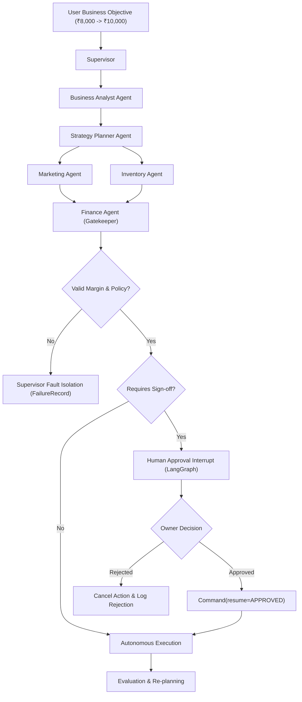

# DUKAANDOST AI 2.0 — MULTI-AGENT WORKFLOW SPECIFICATION
## LangGraph StateGraph Architecture and Agent Specialization

---

### 1. Multi-Agent System Overview
DukaanDost AI 2.0 implements a six-agent autonomous architecture coordinated via LangGraph:

---

### 2. Six Specialized Agents

#### Agent 1: Supervisor Agent
- **File:** `backend/app/agents/supervisor.py`
- **Role:** Master coordinator, LangGraph router, fault isolator.
- **Responsibilities:**
  - Decomposes business goal into structured initiatives.
  - Monitors agent state transitions.
  - Manages human-in-the-loop interrupts and resumptions.

#### Agent 2: Business Analyst Agent
- **File:** `backend/app/agents/business_analyst.py`
- **Role:** Deep business intelligence & transaction ledger retrieval.
- **Responsibilities:**
  - Calculates current net operating income (baseline ₹8,000.00).
  - Determines monthly income gap to target (₹2,000.00).
  - Aggregates customer purchase velocity and AOV.

#### Agent 3: Strategy Planner Agent
- **File:** `backend/app/agents/strategy_planner.py`
- **Role:** Growth strategy formulation and task prioritization.
- **Responsibilities:**
  - Formulates actionable growth initiatives across 4 pillars.
  - Prioritizes initiatives by expected monthly income contribution.
  - Evaluates operational risk level (LOW, MEDIUM, HIGH).

#### Agent 4: Marketing Agent
- **File:** `backend/app/agents/marketing_agent.py`
- **Role:** Promotional bundling and customer outreach.
- **Responsibilities:**
  - Identifies synergistic cross-sell item pairs (e.g. Bread + Butter + Milk).
  - Prepares promotional message drafts with discount limits.
  - Formulates customer reactivation offers.

#### Agent 5: Inventory Agent
- **File:** `backend/app/agents/inventory_agent.py`
- **Role:** Stock replenishment and clearance optimization.
- **Responsibilities:**
  - Flags critical stockouts below safety reorder threshold.
  - Detects slow-moving and near-expiry stock.
  - Formulates reorder quantities and liquidations.

#### Agent 6: Finance Agent (Independent Gatekeeper)
- **File:** `backend/app/agents/finance_agent.py`
- **Role:** Deterministic financial guardrail enforcement.
- **Responsibilities:**
  - Validates every proposal against cost price, proposed price, and policy caps.
  - Strictly halts execution on negative gross margin or sub-5% margin.
  - Enforces the 15% maximum promotional discount cap.

---

### 3. Checkpointing and State Persistence
- Checkpoints are saved in `checkpoints.db` using LangGraph's SQLite saver.
- Interrupted states remain stable across backend server restarts.
- Resumption uses `Command(resume=...)` targeting the exact `thread_id`.
- Duplicate task execution is prevented via state-level task tracking (`completed_tasks`).
