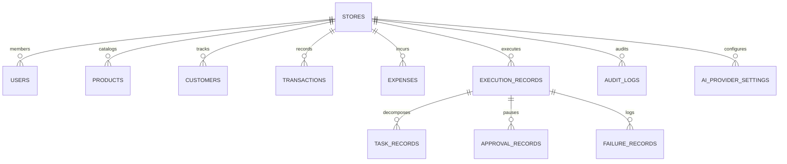

# DUKAANDOST AI 2.0 — DATABASE AUDIT & SCHEMA GUIDE
## Multi-Tenant Relational Data Architecture

---

### 1. Database Configuration
- **Development Engine:** SQLite (`dukaandost.db`)
- **Production Engine:** PostgreSQL 16+ via SQLAlchemy URL
- **Migration Framework:** Alembic (`alembic/`)
- **Multi-Tenancy Key:** `store_id` (Default: `STORE_001` for Sharma General Store)

---

### 2. Entity Relational Mapping (11 Tables)

---

### 3. Core Table Specifications

#### Table 1: `stores`
- `store_id`: Primary key string (`STORE_001`).
- `name`: Business name ("Sharma General Store").
- `location`: Geographical location ("Harmu Road, Ranchi, Jharkhand").
- `initial_net_income`: Baseline monthly net profit (₹8,000.00).
- `target_net_income`: Target monthly net profit (₹10,000.00).
- `current_net_income`: Live reconciled income.

#### Table 2: `products`
- `id`: Integer primary key.
- `store_id`: Multi-tenant isolation key.
- `product_id`: Human-readable identifier (`PROD001` - `PROD032`).
- `product_name`: Item name (e.g. "Amul Butter 500g").
- `category`: Category (Dairy, Spices, Bakery, Staples, Snacks).
- `cost_price`: Unit acquisition cost.
- `selling_price`: Retail shelf price.
- `current_stock`: Live on-hand quantity.
- `minimum_stock`: Safety reorder trigger.
- `status`: "HEALTHY", "LOW STOCK", "OUT OF STOCK", "NEGATIVE MARGIN".

#### Table 3: `failure_records`
- `id`: Unique failure ID.
- `store_id`: Tenant identifier.
- `execution_id`: Execution workflow reference.
- `task_id`: Task identifier.
- `agent_name`: Detecting agent ("Finance Agent").
- `error_description`: Rejection detail and calculation.
- `root_cause`: Violation category (`NEGATIVE_GROSS_MARGIN_VIOLATION`).
- `recovery_status`: "UNRESOLVED", "RESOLVED".
- `retry_count`: Incremented on duplicate triggers.
- `timestamp`: UTC event timestamp.

#### Table 4: `audit_logs`
- `id`: Immutable audit record ID.
- `store_id`: Tenant identifier.
- `execution_id`: Optional workflow reference.
- `event_type`: Event category (`PRICE_RECTIFICATION_VALIDATED`, `FINANCIAL_GUARDRAIL_VIOLATION`).
- `agent_name`: Actor ("Finance Agent", "Supervisor", "Shopkeeper").
- `details`: Full deterministic event payload.
- `timestamp`: UTC timestamp.

#### Table 5: `ai_provider_settings`
- `id`: Integer PK.
- `store_id`: Tenant identifier.
- `provider_name`: "groq", "gemini", "openai", "ollama", "deterministic".
- `model_name`: Configured model identifier.
- `is_enabled`: Boolean flag.
- `is_primary`: Primary routing flag.
- `is_fallback`: Fallback routing flag.

---

### 4. Integrity and Backup Verification
- Foreign keys and tenant filters are applied across all queries.
- Backup scripts available: `scripts/backup_db.py` and `scripts/restore_db.py`.
- Automated migrations: `backend/app/database/migrations.py`.
